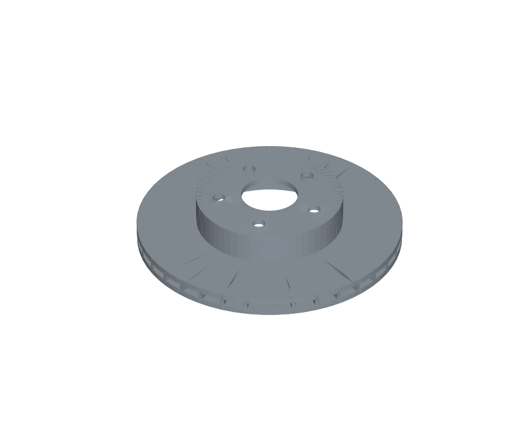
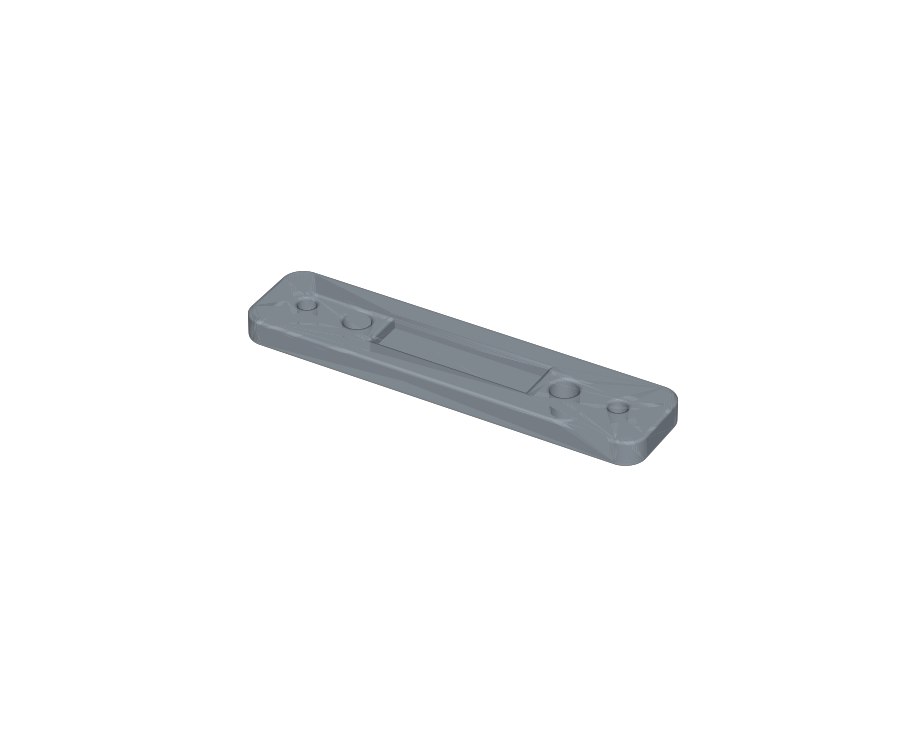

# Parametric Brake CAD

Parametric 3D CAD models of a **vented brake rotor** and a **caliper mounting bracket**, built in code with [CadQuery](https://github.com/CadQuery/cadquery) (an open-source CAD kernel based on OpenCASCADE). Every dimension is a parameter. Change one value, rebuild, and you get new STEP and STL files, 2D drawing views and an updated mass properties report.

The STEP files open directly in **SOLIDWORKS, Fusion 360, FreeCAD, Onshape** or any other CAD program.

| Vented rotor (gray cast iron) | Caliper bracket (1020 steel) |
| --- | --- |
|  |  |

## What's modeled

**Rotor:** 300 mm × 28 mm vented rotor with two 9 mm friction plates, a 10 mm air gap with 36 radial cooling vanes, a 45 mm hat, a 64.1 mm hub bore, and a 5 × 114.3 mm bolt pattern with 14 mm lug holes.

**Bracket:** 190 × 45 × 16 mm plate with 2 knuckle mounting holes (M12 clearance, 100 mm apart), 2 caliper pin holes (150 mm apart), a lightening pocket, rounded corners and edge fillets.

## Mass properties (like SOLIDWORKS Mass Properties)

| Part | Material | Mass | Volume | Center of mass (Z) |
| --- | --- | --- | --- | --- |
| Rotor | Gray cast iron, 7,200 kg/m³ | **8.74 kg** | 1,214 cm³ | 23.8 mm |
| Bracket | 1020 steel, 7,900 kg/m³ | **0.92 kg** | 117 cm³ | 7.6 mm |

8.74 kg is in the normal range for a 300 mm vented passenger car rotor. The center of mass sits on the rotation axis (X = Y = 0), so the model is balanced.

**Design study: friction plate thickness vs rotor mass**

| Plate thickness | 7 mm | 8 mm | 9 mm | 10 mm | 11 mm |
| --- | --- | --- | --- | --- | --- |
| Rotor mass | 7.34 kg | 8.04 kg | 8.74 kg | 9.44 kg | 10.15 kg |

Each extra millimeter on both plates adds about 0.7 kg. That's thermal mass the brakes need for heavy stops, but it's also unsprung weight. This rotor mass plugs into the rotor temperature calculation in [brake-system-calculator](https://github.com/gomdan133-ux/brake-system-calculator).

## Files

```
cad/
  rotor.py        RotorSpec parameters + build_rotor()
  bracket.py      BracketSpec parameters + build_bracket()
  properties.py   volume, mass, center of mass, bounding box
scripts/
  build_all.py    builds everything and writes output/
output/
  rotor.step, bracket.step       3D models for any CAD program
  rotor.stl,  bracket.stl        meshes for 3D printing or viewing
  *_top.svg, *_front.svg, *_iso.svg   drawing views with hidden lines
  rotor.png, bracket.png         renders
  mass_report.json               all parameters and mass properties
tests/            12 pytest tests
```

## Run it

```bash
pip install cadquery matplotlib pytest
python scripts/build_all.py     # rebuild all outputs
pytest -q                        # run the tests
```

Change a dimension:

```python
from cad import RotorSpec, build_rotor, mass_properties
rotor = build_rotor(RotorSpec(outer_d=320, vane_count=40))
print(mass_properties(rotor)["mass_kg"])
```

## How this was built

1. **Started from parts I work on.** These are a common 300 mm vented rotor with a 5 × 114.3 bolt pattern and a flat caliper bracket. The dimensions are typical, not copied from any one manufacturer's drawing.
2. **Modeled it the way a CAD program does.** Each part is built from sketches (circles, rectangles), extrudes, unions for the vanes and hat, cuts for the bore and lug holes, and fillets. That's the same feature sequence you'd use in SOLIDWORKS.
3. **Made it parametric and checked the inputs.** Every dimension lives in a spec class, and impossible geometry is rejected (for example, lug holes that would hit the center bore).
4. **Validated the output.** Tests check that each part is one valid solid, has the right overall size, a realistic mass, and a balanced center of mass, and that thicker plates add mass and aluminum weighs less than iron.
5. **Exported real CAD formats.** The project exports STEP for CAD programs, STL for meshes, SVG drawing views with hidden lines, and a mass report.

**Limits:** the rotor and bracket are simplified. They have no vane curvature, cross-drilling or slots, and no tolerances or GD&T on the drawings. They aren't for manufacturing.

## License

MIT
